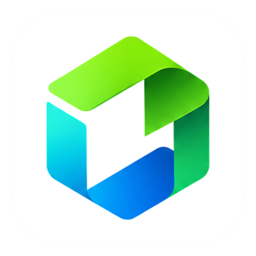
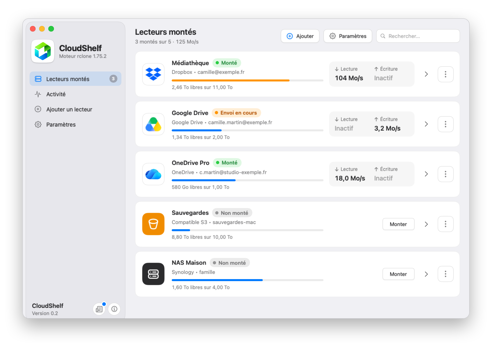
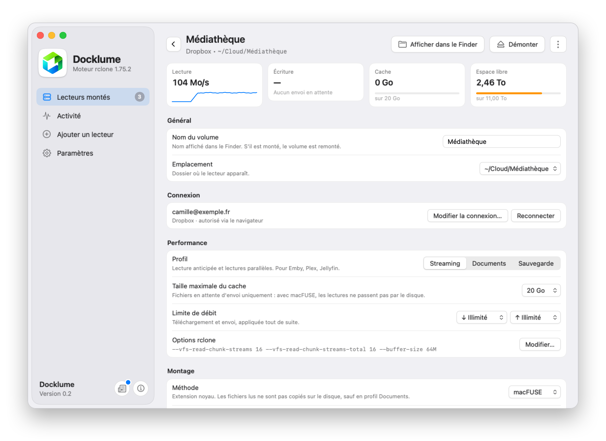
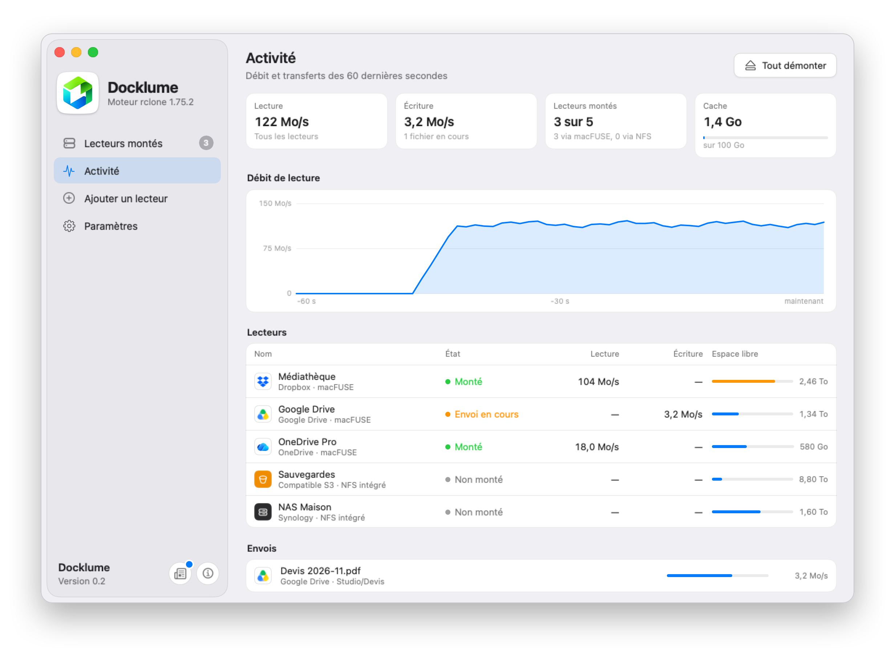
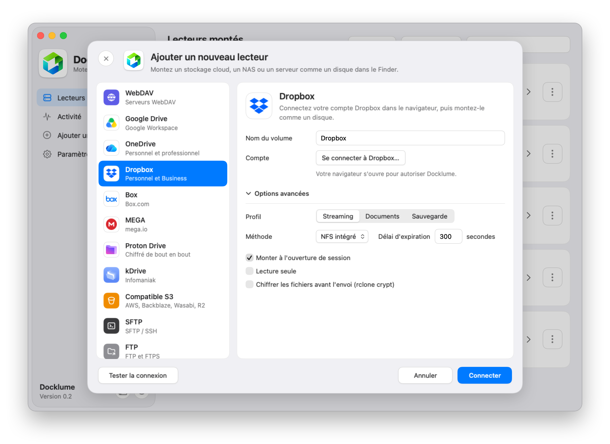
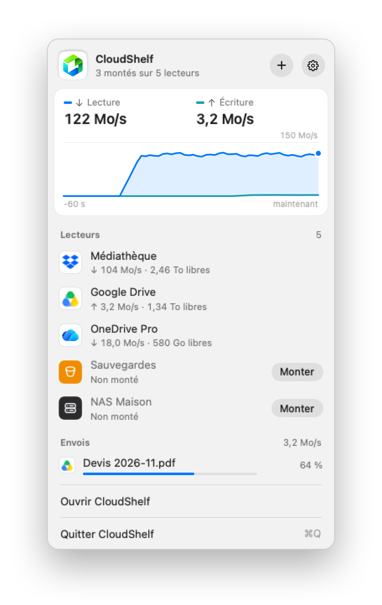
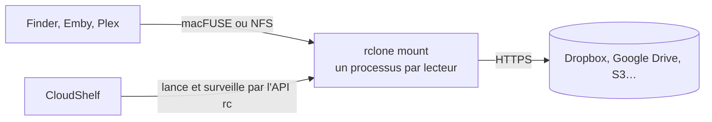

<p align="center">
  
</p>

<h1 align="center">CloudShelf</h1>

<p align="center">
  <b>Vos stockages en ligne, montés comme des disques dans le Finder.</b><br>
  Dropbox, Google Drive, OneDrive, S3, NAS… en un clic, à pleine vitesse, sur un moteur rclone optimisé.
</p>

<p align="center">
  
  
  
  
  <a href="LICENSE"></a>
</p>

<p align="center">
  <picture>
    <source media="(prefers-color-scheme: dark)" srcset="docs/images/drives-dark.png">
    
  </picture>
</p>

CloudShelf transforme chaque compte en ligne en un lecteur du Finder, comme RaiDrive sous Windows. L'app est native, en SwiftUI, et pilote [rclone](https://rclone.org) : un processus par lecteur, réglé pour le service et pour l'usage, avec le débit affiché en direct.

## Points forts

- **Rapide.** Le moteur rclone fourni avec l'app répartit 16 connexions entre les fichiers lus. Sur Dropbox, une lecture monte à 60 Mo/s, et plusieurs lectures saturent une ligne à 110 Mo/s.
- **Deux façons de monter.** macFUSE lit directement depuis le réseau, sans rien écrire sur le disque. Le client NFS intégré à macOS ne demande aucune installation.
- **Un profil par usage.** *Streaming* pour Emby, Plex et Jellyfin, *Documents* pour le travail courant, *Sauvegarde* pour les grosses copies.
- **Le débit en direct.** Un graphique dans la barre des menus, une page Activité, et un test de débit par lecteur.
- **Vos envois protégés.** CloudShelf garde dans le cache tout fichier pas encore envoyé, même quand vous videz le cache, et prévient avant de démonter ou de quitter.
- **Le disque protégé.** Quand l'espace libre baisse, CloudShelf vide le cache du lecteur qui en libère le plus, sans toucher aux envois en attente.
- **Sans surprise.** Reconnexion automatique si rclone s'arrête, limite de débit appliquée à chaud, fichiers `.DS_Store` et `._*` tenus à l'écart du cloud.
- **Privé.** Aucun serveur, aucune télémétrie : vos identifiants restent dans `rclone.conf`, sur votre Mac.

## En images

<table>
  <tr>
    <td width="50%" valign="top">
      <picture>
        <source media="(prefers-color-scheme: dark)" srcset="docs/images/detail-dark.png">
        
      </picture>
      <p align="center"><b>Fiche du lecteur</b><br><sub>Profil, cache, limite de débit, méthode de montage</sub></p>
    </td>
    <td width="50%" valign="top">
      <picture>
        <source media="(prefers-color-scheme: dark)" srcset="docs/images/activity-dark.png">
        
      </picture>
      <p align="center"><b>Activité</b><br><sub>Débit des 60 dernières secondes, lecteur par lecteur</sub></p>
    </td>
  </tr>
  <tr>
    <td width="50%" valign="top">
      <picture>
        <source media="(prefers-color-scheme: dark)" srcset="docs/images/add-dark.png">
        
      </picture>
      <p align="center"><b>Ajout d'un lecteur</b><br><sub>Connexion par le navigateur pour les services OAuth</sub></p>
    </td>
    <td width="50%" align="center" valign="top">
      <picture>
        <source media="(prefers-color-scheme: dark)" srcset="docs/images/panel-dark.png">
        
      </picture>
      <p align="center"><b>Barre des menus</b><br><sub>Débit, lecteurs et envois d'un coup d'œil</sub></p>
    </td>
  </tr>
</table>

## Services pris en charge

| Cloud | Serveurs et NAS |
| --- | --- |
| Dropbox · Google Drive · OneDrive · Box · MEGA · Proton Drive · kDrive · compatibles S3 (AWS, Backblaze, Wasabi, R2) | WebDAV · SFTP · FTP et FTPS · SMB · Synology · QNAP · Nextcloud et ownCloud |

Les remotes déjà présents dans votre `rclone.conf` sont importés au premier lancement, en lecture seule. Le chiffrement rclone crypt se coche à l'ajout d'un lecteur.

## Performances

Mesuré sur un compte Dropbox réel, avec une ligne d'environ 110 Mo/s :

| Mesure | Résultat |
| --- | --- |
| Lecture d'un seul fichier | 60 Mo/s |
| Deux fichiers lus en même temps | 71 Mo/s au total |
| Plusieurs lectures | 100 à 110 Mo/s, le plafond de la ligne |
| Envoi d'un fichier de 1 Go | 31 s, contre 56 s avec les réglages par défaut de rclone |
| Envoi de 50 petits fichiers | 15 s, contre 40 s |

Dropbox accepte environ 16 téléchargements simultanés par compte et refuse ou ralentit au-delà. Le moteur de CloudShelf reste sous cette limite tout en donnant à chaque fichier lu autant de connexions qu'il peut en utiliser.

## Fonctionnement



- Chaque lecteur a son propre processus rclone, son propre dossier de cache et son serveur de contrôle sur `127.0.0.1`, protégé par un mot de passe tiré à chaque lancement.
- L'app lit le débit, les envois et l'état du cache par l'API rc de rclone, une fois par seconde.
- Les réglages de montage sont regroupés dans `MountOptions` ([Drive.swift](CloudShelf/Model/Drive.swift)), avec la mesure qui justifie chacun.

### Le moteur rclone modifié

CloudShelf embarque rclone 1.75.2 avec deux correctifs, dans [`rclone-patches/`](rclone-patches) :

| Correctif | Rôle |
| --- | --- |
| [**Connexions partagées**](rclone-patches/0001-vfs-shared-read-streams.patch) | Ajoute `--vfs-read-chunk-streams-total`, un budget de connexions partagé par tous les fichiers ouverts. Une lecture démarre avec 4 connexions et en prend davantage tant qu'elle attend le réseau. |
| [**Octets reçus**](rclone-patches/0002-core-downloaded.patch) | Ajoute l'appel rc `core/downloaded`, qui compte les octets reçus du réseau. `core/stats` ne les compte qu'une fois lus par l'app, ce que macFUSE fait par paquets de plusieurs centaines de mégaoctets. |

## Compiler

**Prérequis :** macOS 15 ou plus récent sur Apple Silicon, Xcode 26, [Go](https://go.dev/dl/) 1.26 et [macFUSE](https://macfuse.github.io) 5, nécessaire pour compiler le moteur.

```bash
git clone https://github.com/LFR-54/CloudShelf.git
cd CloudShelf
scripts/build-rclone.sh
xcodebuild -project CloudShelf.xcodeproj -scheme CloudShelf -configuration Release -derivedDataPath build/DerivedData build
open build/DerivedData/Build/Products/Release/CloudShelf.app
```

`build-rclone.sh` télécharge rclone 1.75.2, applique les correctifs et produit `build/rclone/rclone`, que Xcode copie dans l'app.

**Pour monter avec macFUSE**, autorisez son extension dans Réglages Système › Confidentialité et sécurité. Sur Apple Silicon, macOS demande d'abord de passer en sécurité réduite depuis le mode de récupération. Sans macFUSE, choisissez « NFS intégré » dans la fiche du lecteur.

## Google Drive : utilisez votre propre clé

rclone se connecte par défaut à Google Drive avec une clé partagée par tous ses utilisateurs. Google limite souvent cette clé, ce qui ralentit le montage et la navigation, et rclone annonce son retrait courant 2026. Avec votre propre clé, gratuite, vous avez votre propre quota : suivez le [guide de rclone](https://rclone.org/drive/#making-your-own-client-id).

## Confidentialité

CloudShelf ne collecte rien et ne passe par aucun serveur : votre Mac échange directement avec les services que vous connectez. Les détails sont dans les [règles de confidentialité](https://lfr-54.github.io/CloudShelf/confidentialite.html).

## Licence

CloudShelf est publié sous [licence MIT](LICENSE). rclone est un logiciel de Nick Craig-Wood et de ses contributeurs, sous licence MIT ; les correctifs de `rclone-patches/` sont publiés sous la même licence. macFUSE n'est pas inclus et garde sa propre licence.
